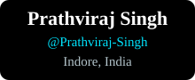
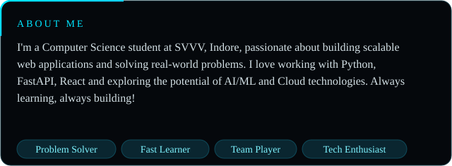
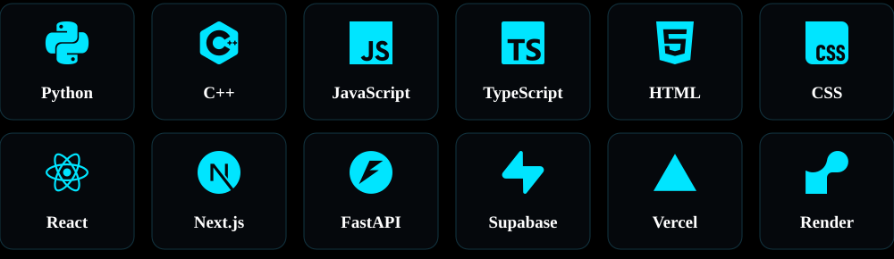

<table align="center">
<tr>
<td width="240" align="center" valign="middle">

 

</td>
<td valign="middle">

</td>
</tr>
</table>

<table align="center">
<tr>
<td align="center" valign="top">
 

</td>
<td align="center" valign="top">
 

</td>
<td align="center" valign="top">
 

</td>
</tr>
</table>

  
  
  

